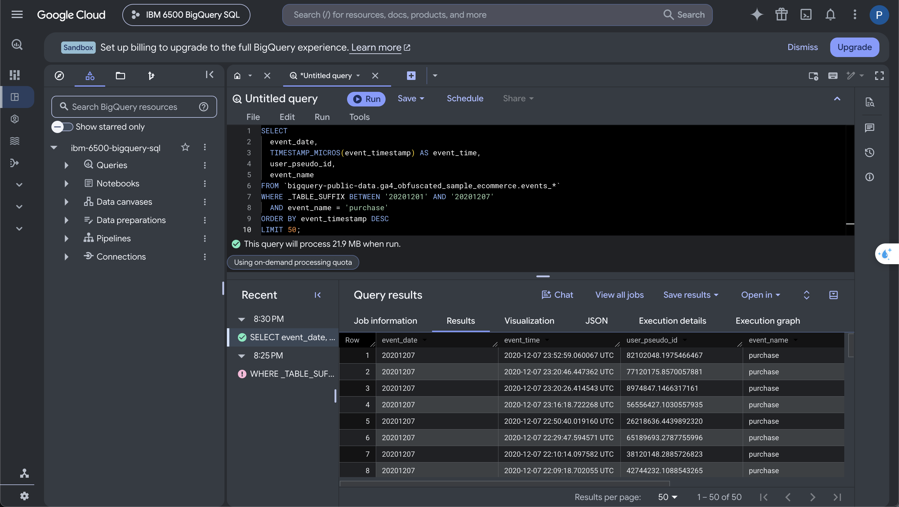
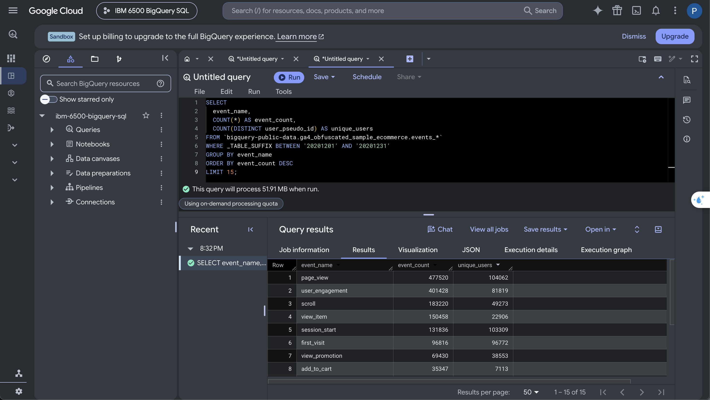
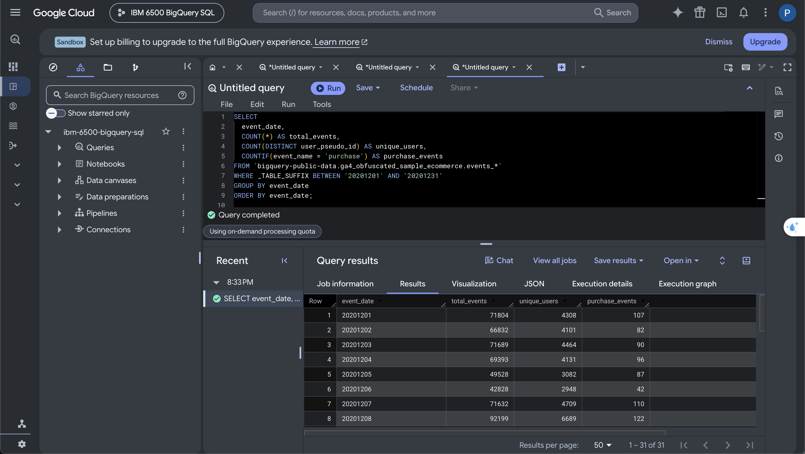
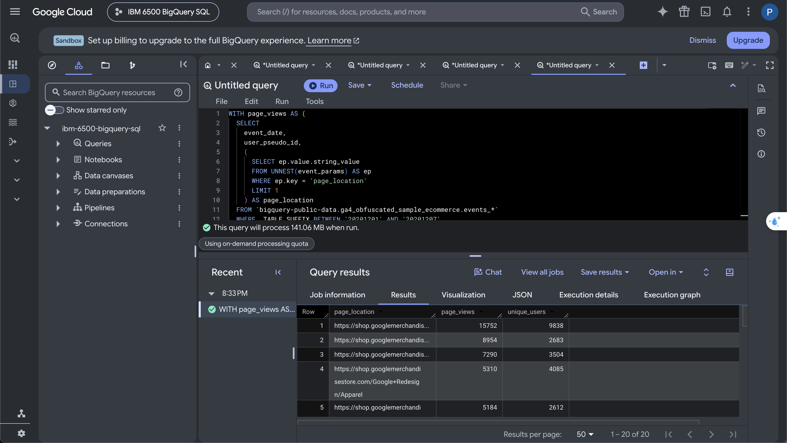
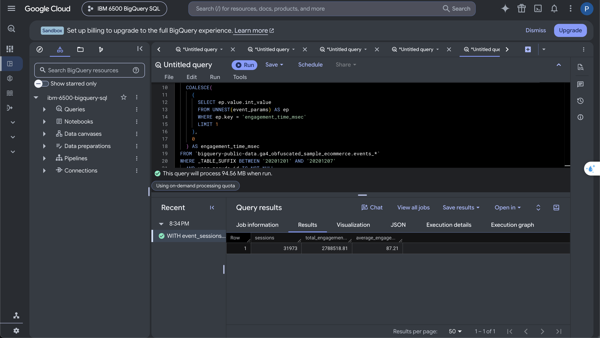
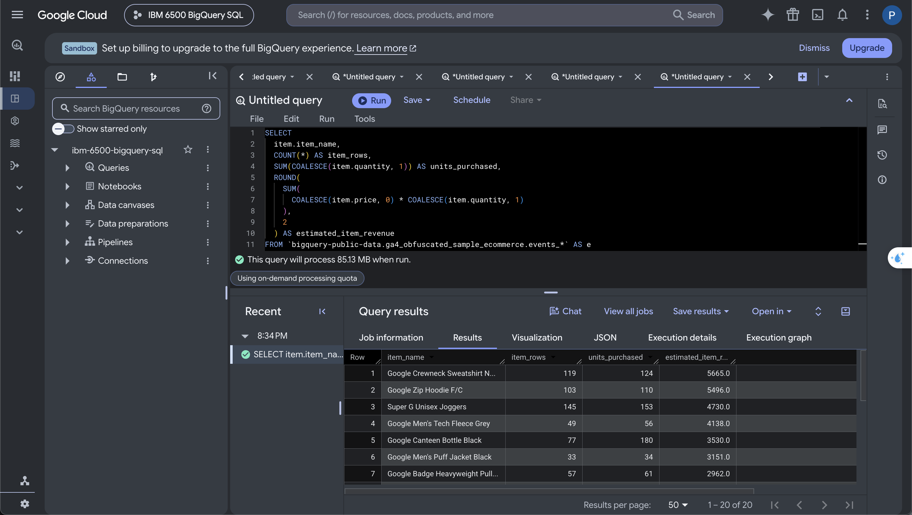
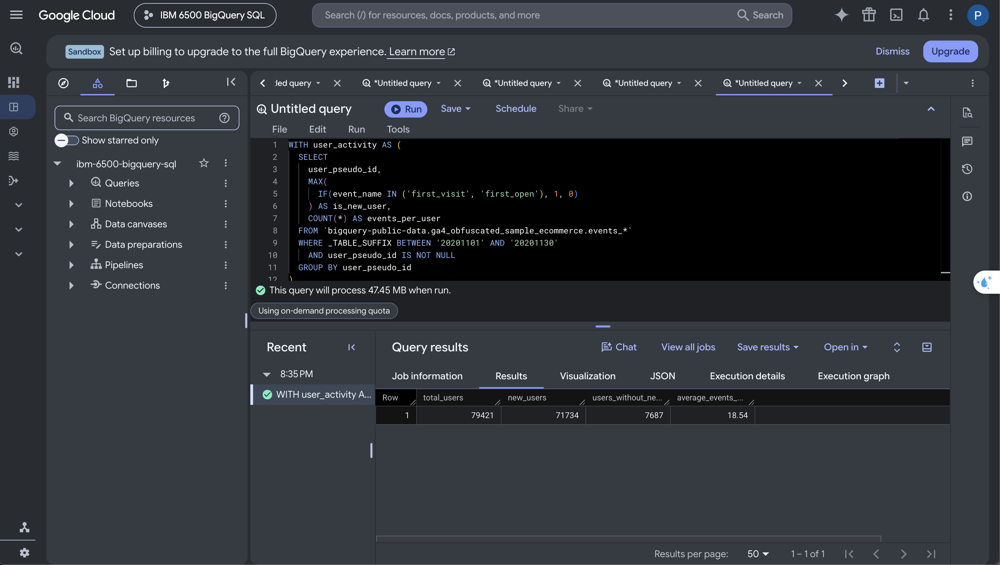
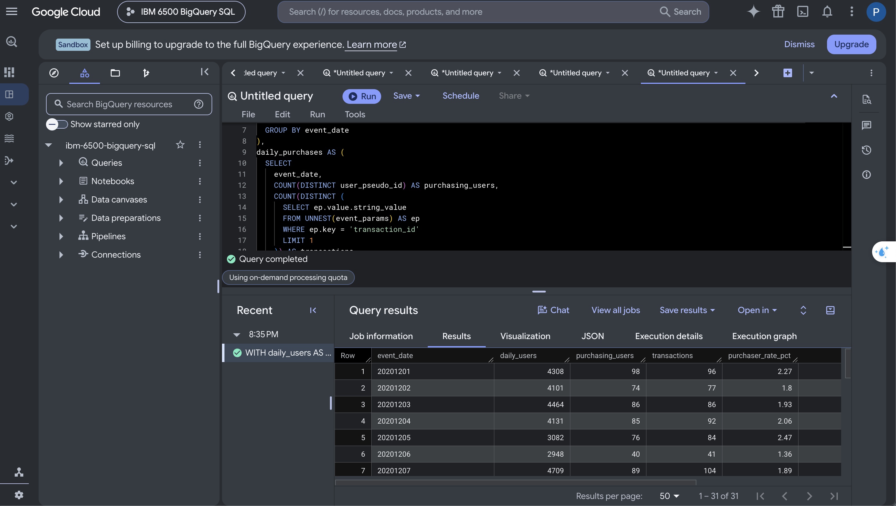

# Query 1: Purchase Events in a Selected Week

## SQL Query

``` sql
SELECT
  event_date,
  TIMESTAMP_MICROS(event_timestamp) AS event_time,
  user_pseudo_id,
  event_name
FROM `bigquery-public-data.ga4_obfuscated_sample_ecommerce.events_*`
WHERE _TABLE_SUFFIX BETWEEN '20201201' AND '20201207'
  AND event_name = 'purchase'
ORDER BY event_timestamp DESC
LIMIT 50;
```

## Explanation

This query returns purchase events recorded from December 1 through December 7, 2020. It converts the GA4 microsecond timestamp into a readable timestamp and sorts the newest events first. It is useful for checking individual purchase activity before creating a summary. Each row is an event, so it should not automatically be interpreted as one unique customer or transaction.

## Screenshot



# Query 2: Most Common Event Types

## SQL Query

``` sql
SELECT
  event_name,
  COUNT(*) AS event_count,
  COUNT(DISTINCT user_pseudo_id) AS unique_users
FROM `bigquery-public-data.ga4_obfuscated_sample_ecommerce.events_*`
WHERE _TABLE_SUFFIX BETWEEN '20201201' AND '20201231'
GROUP BY event_name
ORDER BY event_count DESC
LIMIT 15;
```

## Explanation

This query identifies the 15 most frequent event types in December 2020. `COUNT(*)` measures events, while `COUNT(DISTINCT user_pseudo_id)` estimates the number of users who generated each event type. It is useful for understanding which user behaviors are most common. The event count and user count are different metrics because one user can generate the same event many times.

## Screenshot



# Query 3: Daily Events, Users, and Purchases

## SQL Query

``` sql
SELECT
  event_date,
  COUNT(*) AS total_events,
  COUNT(DISTINCT user_pseudo_id) AS unique_users,
  COUNTIF(event_name = 'purchase') AS purchase_events
FROM `bigquery-public-data.ga4_obfuscated_sample_ecommerce.events_*`
WHERE _TABLE_SUFFIX BETWEEN '20201201' AND '20201231'
GROUP BY event_date
ORDER BY event_date;
```

## Explanation

This query creates a daily summary of all events, unique users, and purchase events. It is useful for finding changes in traffic and purchasing activity over time. The result contains one row per date because `event_date` controls the grouping level. `purchase_events` counts event rows and may not equal the number of distinct transactions.

## Screenshot



# Query 4: Top Page Locations

## SQL Query

``` sql
WITH page_views AS (
  SELECT
    event_date,
    user_pseudo_id,
    (
      SELECT ep.value.string_value
      FROM UNNEST(event_params) AS ep
      WHERE ep.key = 'page_location'
      LIMIT 1
    ) AS page_location
  FROM `bigquery-public-data.ga4_obfuscated_sample_ecommerce.events_*`
  WHERE _TABLE_SUFFIX BETWEEN '20201201' AND '20201207'
    AND event_name = 'page_view'
)
SELECT
  page_location,
  COUNT(*) AS page_views,
  COUNT(DISTINCT user_pseudo_id) AS unique_users
FROM page_views
WHERE page_location IS NOT NULL
GROUP BY page_location
ORDER BY page_views DESC
LIMIT 20;
```

## Explanation

This query extracts the `page_location` parameter from page-view events and ranks the most viewed URLs. The parameter is read from `event_params` using `string_value` because a page URL is text. A CTE keeps the extraction step separate from the summary step. Full URLs may contain query strings, so similar pages can appear as separate rows if their URLs differ.

## Screenshot



# Query 5: Session Engagement from Integer Parameters

## SQL Query

``` sql
WITH event_sessions AS (
  SELECT
    user_pseudo_id,
    (
      SELECT ep.value.int_value
      FROM UNNEST(event_params) AS ep
      WHERE ep.key = 'ga_session_id'
      LIMIT 1
    ) AS session_id,
    COALESCE(
      (
        SELECT ep.value.int_value
        FROM UNNEST(event_params) AS ep
        WHERE ep.key = 'engagement_time_msec'
        LIMIT 1
      ),
      0
    ) AS engagement_time_msec
  FROM `bigquery-public-data.ga4_obfuscated_sample_ecommerce.events_*`
  WHERE _TABLE_SUFFIX BETWEEN '20201201' AND '20201207'
    AND user_pseudo_id IS NOT NULL
)
SELECT
  COUNT(DISTINCT CONCAT(
    user_pseudo_id,
    '-',
    CAST(session_id AS STRING)
  )) AS sessions,
  ROUND(SUM(engagement_time_msec) / 1000, 2) AS total_engagement_seconds,
  ROUND(
    SAFE_DIVIDE(
      SUM(engagement_time_msec) / 1000,
      COUNT(DISTINCT CONCAT(
        user_pseudo_id,
        '-',
        CAST(session_id AS STRING)
      ))
    ),
    2
  ) AS average_engagement_seconds_per_session
FROM event_sessions
WHERE session_id IS NOT NULL;
```

## Explanation

This query extracts `ga_session_id` and `engagement_time_msec` using `int_value`, then calculates session and engagement totals. Combining the user ID with the session ID creates a safer session key than using the session ID alone. This output is useful for estimating average engagement per session. Missing engagement values are treated as zero, which may lower the calculated average.

## Screenshot



# Query 6: Product Units and Item Revenue

## SQL Query

``` sql
SELECT
  item.item_name,
  COUNT(*) AS item_rows,
  SUM(COALESCE(item.quantity, 1)) AS units_purchased,
  ROUND(
    SUM(
      COALESCE(item.price, 0) * COALESCE(item.quantity, 1)
    ),
    2
  ) AS estimated_item_revenue
FROM `bigquery-public-data.ga4_obfuscated_sample_ecommerce.events_*` AS e
CROSS JOIN UNNEST(e.items) AS item
WHERE _TABLE_SUFFIX BETWEEN '20201201' AND '20201231'
  AND e.event_name = 'purchase'
  AND item.item_name IS NOT NULL
GROUP BY item.item_name
ORDER BY estimated_item_revenue DESC
LIMIT 20;
```

## Explanation

This query expands the repeated `items` array and summarizes product units and estimated revenue. It is useful for identifying products that contributed the most sales during the month. After `UNNEST(items)`, the data is at the item-row level rather than the event level. The revenue calculation assumes missing quantity equals one and does not account for refunds, tax, or shipping.

## Screenshot



# Query 7: New and Returning User Summary with a CTE

## SQL Query

``` sql
WITH user_activity AS (
  SELECT
    user_pseudo_id,
    MAX(
      IF(event_name IN ('first_visit', 'first_open'), 1, 0)
    ) AS is_new_user,
    COUNT(*) AS events_per_user
  FROM `bigquery-public-data.ga4_obfuscated_sample_ecommerce.events_*`
  WHERE _TABLE_SUFFIX BETWEEN '20201101' AND '20201130'
    AND user_pseudo_id IS NOT NULL
  GROUP BY user_pseudo_id
)
SELECT
  COUNT(*) AS total_users,
  SUM(is_new_user) AS new_users,
  COUNTIF(is_new_user = 0) AS users_without_new_user_event,
  ROUND(AVG(events_per_user), 2) AS average_events_per_user
FROM user_activity;
```

## Explanation

This query first creates one row per user and flags whether the user generated a `first_visit` or `first_open` event during November 2020. The final query reports total users, new users, users without a new-user event, and average events per user. The CTE makes the user-level logic easy to reuse. A user without a new-user event in this date range is not necessarily a confirmed returning user because their first event may be outside the available data.

## Screenshot



# Query 8: Daily Users Joined with Purchase Performance

## SQL Query

``` sql
WITH daily_users AS (
  SELECT
    event_date,
    COUNT(DISTINCT user_pseudo_id) AS daily_users
  FROM `bigquery-public-data.ga4_obfuscated_sample_ecommerce.events_*`
  WHERE _TABLE_SUFFIX BETWEEN '20201201' AND '20201231'
  GROUP BY event_date
),
daily_purchases AS (
  SELECT
    event_date,
    COUNT(DISTINCT user_pseudo_id) AS purchasing_users,
    COUNT(DISTINCT (
      SELECT ep.value.string_value
      FROM UNNEST(event_params) AS ep
      WHERE ep.key = 'transaction_id'
      LIMIT 1
    )) AS transactions
  FROM `bigquery-public-data.ga4_obfuscated_sample_ecommerce.events_*`
  WHERE _TABLE_SUFFIX BETWEEN '20201201' AND '20201231'
    AND event_name = 'purchase'
  GROUP BY event_date
)
SELECT
  u.event_date,
  u.daily_users,
  IFNULL(p.purchasing_users, 0) AS purchasing_users,
  IFNULL(p.transactions, 0) AS transactions,
  ROUND(
    SAFE_DIVIDE(
      IFNULL(p.purchasing_users, 0),
      u.daily_users
    ) * 100,
    2
  ) AS purchaser_rate_pct
FROM daily_users AS u
LEFT JOIN daily_purchases AS p
  ON u.event_date = p.event_date
ORDER BY u.event_date;
```

## Explanation

This query builds separate daily traffic and purchase summaries, then joins them by date. It reports daily users, purchasing users, distinct transactions, and the percentage of users who purchased. The left join preserves dates that have traffic but no recorded purchases. The percentage is a daily purchaser rate, not a session-based ecommerce conversion rate.

## Screenshot



# Appendix

**GitHub Repository:** [IBM-6500-GA4-Milestone4-SQL-Pack](https://github.com/gracesen/IBM-6500-GA4-Milestone4-SQL-Pack)

**GitHub Pages:** [Published GA4 SQL Pack](https://gracesen.github.io/IBM-6500-GA4-Milestone4-SQL-Pack/)
